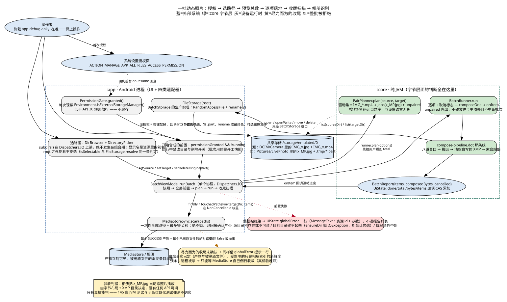
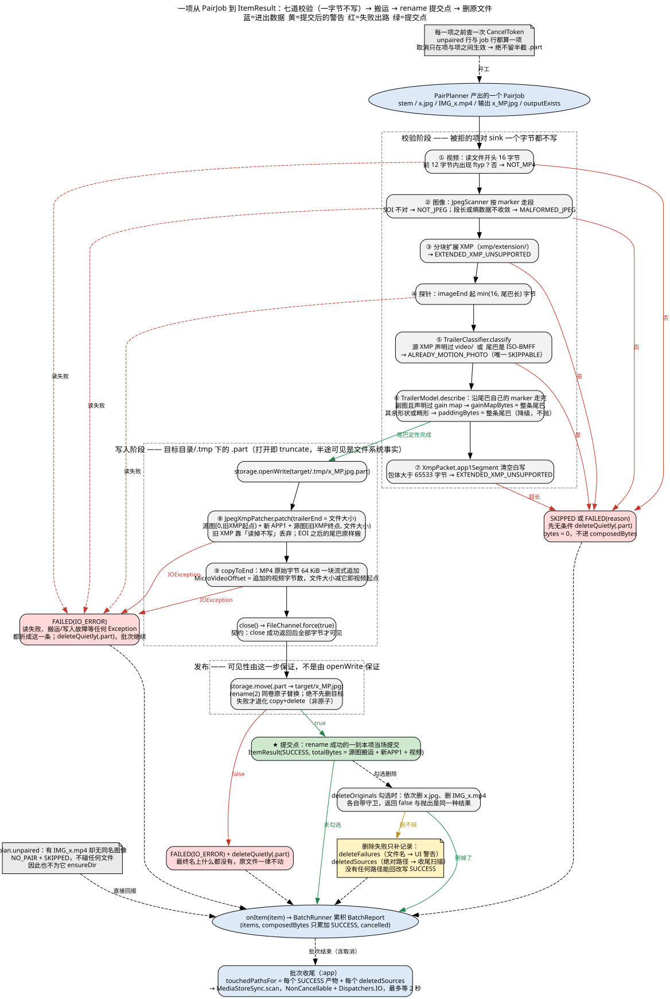

# vlive

Android 上的批量动态照片合成工具：选一个目录，把**同名**的 `IMG_x.jpg` 与 `IMG_x.mp4` 合成一张符合
Google **Motion Photo 1.0** 的单文件动态照片 `x_MP.jpg`，写到另一个目录，并让相册立刻认得它。

不解码、不转码、不重编码 —— 纯字节搬运加元数据重写。源 JPEG 整文件进产物（连 EOI 之后的 HDR 副图与
厂商记录一起），视频原始字节追加在文件末尾，中间夹的那份 XMP 目录负责把**每一段字节都声明出来**。

> 这是一台设备上、离线跑的侧载工具，不是商店应用。判据来自 vivo V2419A 的真机实验；
> 其他厂商机型没有通过样本，见 [文档索引](docs/README.md#当前已知的未知)。

## 装与用

```bash
./gradlew :app:assembleDebug
adb install -r app/build/outputs/apk/debug/app-debug.apk
adb shell am start -n dev.zayn.vlive/dev.zayn.vlive.MainActivity
```

1. 首次打开授予「所有文件访问」权限（`MANAGE_EXTERNAL_STORAGE`）。没有它读写公共目录会被系统拒绝，
   批次不会开始；vivo 上跳转可能落不到系统页，那时给出手动指引，回前台再回查一次。
2. 选源目录与目标目录（默认 `/storage/emulated/0/DCIM/Camera` → `/storage/emulated/0/Pictures/LivePhoto`，
   也可以逐级浏览挑选）。目标目录不存在会自动创建；两个目录**可以是同一个**（原地生成安全）。
3. 「开始合成」跑批，「取消」在当前项落盘后停止 —— 正在写的项一定走完改名或清理，**不会留半截 `.part`**。
4. 产物名 `<stem>_MP.jpg`，同名已存在则**原子替换**（不先删旧文件）。
5. 「合成后删除原文件」默认不勾。勾上时只在产物改名**成功之后**才删 `x.jpg` 与 `IMG_x.mp4`；
   删不掉只记成警告，产物不会被回退成失败。

只有 `IMG_` 前缀的 `.mp4` 会被拿去配对 —— 相机目录里的录屏、下载的短视频、聊天工具存下的 mp4
不会被误当动态照片素材。上一轮产物（`_MP` 结尾）不会被再吃一遍，重复运行报「已是动态照片」并跳过。

## 产物形态

```
SOI │ 源图[2, 旧XMP起点) │ 新 XMP APP1 │ 源图[旧XMP终点, 文件大小) │ 视频字节
                                     ↑ 写回旧段原位，EXIF 仍排在 XMP 之前
GCamera:MicroVideoOffset == MotionPhoto 项的 Item:Length == 实际追加的视频字节数
→ 文件大小 − MicroVideoOffset == 视频起点
```

EOI 与视频之间那段尾巴按形状声明成 `GainMap` 项或主图的 `Padding`，**不留一段没人声明的字节**。
唯一的例外处理是 vivo 相机末盒：`com.android.camera.livephoto` 的值必须以 `motionphoto` 开头这台机器才认。

完整规则（命名、目录声明矩阵、XMP 字段依据、厂商反例、明确不做的事）在
[docs/motion-photo-container.md](docs/motion-photo-container.md)。

## 架构一句话

`:core` 是纯 JVM 库，字节层面的判断全在里面；`:app` 只提供文件、权限、目录浏览、媒体扫描四类适配器
加一屏 UI。两者的边界是**构建隔离**（`:core` 无 `import android`），不是进程边界 —— 打包成同一个 APK。
`:core` 不知道 `java.io.File` 存在，全部文件动作走 `BatchStorage` 端口（7 个方法），所以 145 条测试
不需要设备。批次是顺序单线程：一个协程、一条 `for`、一次一项、逐项回报。

两张图看完全部：

| 一批的端到端 | 一项的合成流水线 |
| --- | --- |
|  |  |

## 文档

| 想知道 | 看哪里 |
| --- | --- |
| 从哪读起、各文档分工、渲染验证状态 | [docs/README.md](docs/README.md) |
| 模块、边界、端口契约、数据与状态、未知区 | [docs/architecture/system-model.md](docs/architecture/system-model.md) |
| 每条架构断言对应哪个文件哪一行、置信度多高 | [docs/architecture/system-model.evidence.md](docs/architecture/system-model.evidence.md) |
| 字节布局、XMP 目录规则、尾巴声明、vivo 末盒、厂商差异 | [docs/motion-photo-container.md](docs/motion-photo-container.md) |
| 为什么这样设计、哪些地方刻意不寻常、已知技术债 | [docs/decisions.md](docs/decisions.md) |
| 测试怎么分的、钉住了什么、真机该验什么 | [docs/testing.md](docs/testing.md) |
| C4 四视图（Context / Container / 两个 Component） | [docs/architecture/vlive.structurizr.dsl](docs/architecture/vlive.structurizr.dsl) |

## 开发

```bash
./gradlew :core:test                    # 145 条纯 JVM 测试，最快的反馈
./gradlew :app:testDebugUnitTest        # 32 条 ViewModel / DirBrowser / PermissionGate
./gradlew :app:connectedDebugAndroidTest # 8 条端口契约测试，需要插设备（CI 只编译不执行）
./gradlew :app:lintDebug                # CI 不跑；当前 12 条 information 级基线：一条被迫保留的 `-v26`、两条刻意撤销的 monochrome、一条 `PluralsCandidate` 误报
```

图标与启动：桌面图标是纯 XML 的 adaptive icon（零 PNG，**两层结构只有 `background` + `foreground`，
刻意不给 `<monochrome>`** —— 有就会被主题图标重染，深色下白变黑）；冷启动走
`androidx.core:core-splashscreen`，logo 淡出后由 `BatchScreen` 的各段交错上浮接住（同一套 220ms 令牌，
带 600ms 超时兜底，绝不让界面停在 alpha 0）。理由与代价见
[docs/decisions.md §5.11-5.12](docs/decisions.md)。

语言与主题：界面文案全在资源里，**默认配置是英文**、中文在 `values-zh`，跟随系统语言；深浅色同样跟随
系统（判定只在 `IosTheme` 一处），窗口级颜色由 `values-night/` 负责，所以深色下冷启动那一帧是黑的而
logo 里的白图形不会变黑。见 [docs/decisions.md §5.14-5.15](docs/decisions.md)。

要求：JDK 17、Android SDK（`compileSdk 37.0`、`platforms;android-37.0`）。`local.properties` 里写 `sdk.dir`。

云端出包：push 到 `main` 或 `feat/*` 会触发 GitHub Actions，`apk` job 上传 `vlive-debug` 与
`vlive-release` 两个产物。release 沿用 debug 签名 —— 能侧载，不能上商店（见
[docs/decisions.md §6.5](docs/decisions.md)）。本地等价命令：`./gradlew :app:assembleRelease`，产物在
`app/build/outputs/apk/release/app-release.apk`。

改了 `XmpPacket` / `VivoLivePhotoTail` / 尾巴声明规则之后，**必须重跑真机验收**
（[清单在 docs/testing.md](docs/testing.md#真机验收清单改了字节层就必须重跑)）—— 没有任何自动化测试能证明相册认这份布局。

## 刻意不做的

不解码/不转码/不重编码主图（真机实测：重编码过的主图不被认）；不处理分块扩展 XMP；不吃 HEIC/AVIF；
不递归子目录；不合并源 XMP 属性；不伪造读不懂的厂商结构；不校验视频完整性（只探起始 12 字节的 `ftyp`）。
每条理由与代价在 [docs/decisions.md](docs/decisions.md)。
