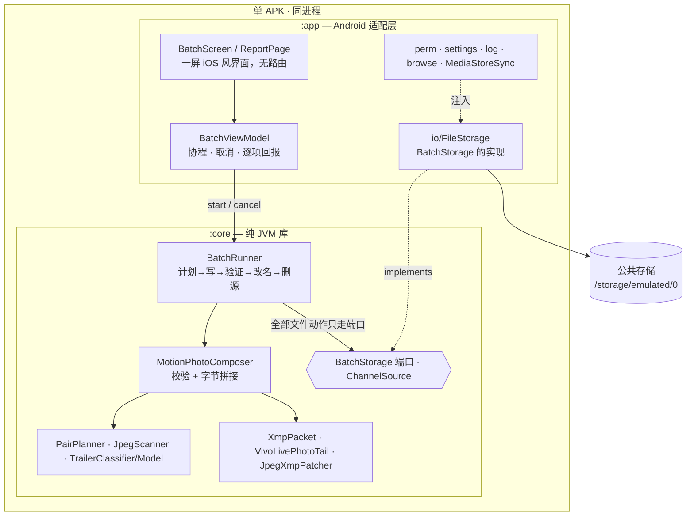
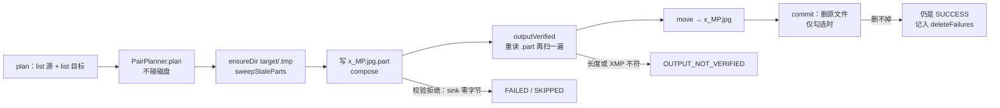

# vlive

Android 上的批量动态照片合成工具：选一个目录，把**同名**的 `IMG_x.jpg` 与 `IMG_x.mp4` 合成一张符合
Google **Motion Photo 1.0** 的单文件动态照片 `x_MP.jpg`，写到另一个目录，并让系统相册立刻认得它。

不解码、不转码、不重编码。源 JPEG **整文件**进产物（连 EOI 之后的 HDR 副图与厂商记录一起搬），视频原始字节
追加在文件末尾，中间替换的那份 XMP 负责把每一段字节都声明出来（`core/src/main/kotlin/dev/zayn/vlive/core/MotionPhotoComposer.kt:26-36`）。

判据来自一台 vivo V2419A 的真机实验。这是离线跑的侧载工具，不是商店应用。

## 输入与输出

| | 规则 | 依据 |
| --- | --- | --- |
| 驱动集 | 只有**视频**驱动配对：`.mp4` 且文件名以 `IMG_` 开头（大小写不敏感） | `PairPlanner.kt:69,82-83` |
| 配图 | 同 stem 的 `.jpg` / `.jpeg` | `PairPlanner.kt:79-80` |
| 产物名 | `<stem>_MP.jpg`，与 Pixel 的 `IMG_xxxxMP.jpg` 同形 | `PairPlanner.kt:58-63,97` |
| 排序 | 按 stem 的 `String.compareTo`，字典序：`IMG_10` 排在 `IMG_2` 之前 | `PairPlanner.kt:51-55` |
| 只一层 | 目录不递归；`list()` 只返回可读的普通文件 | `FileStorage.kt:84-91` |
| 不吃自己 | stem 以 `_MP` 结尾的图片被跳过，上一轮产物不会被再吃一遍 | `PairPlanner.kt:80` |
| 静默忽略 | 其他扩展名（含 `.heic`）、无扩展名、无配对视频的普通照片：不配对也不报 | `PairPlanner.kt:23-29,36,111-114` |

`IMG_` 前缀是有意的：相机目录里躺着录屏、下载的短视频和聊天工具存下的 mp4，它们不是动态照片素材。

## 产物字节布局

```
SOI │ 源图[0, 旧XMP起点) │ 新 XMP APP1 │ 源图[旧XMP终点, 文件大小) │ 视频字节
                                   ↑ 写回旧段原位，源片里的 EXIF 仍排在 XMP 之前
GCamera:MicroVideoOffset == MotionPhoto 项的 Item:Length == 实际追加的视频字节数
→ 文件大小 − MicroVideoOffset == 视频起点（imageEnd 在更前面）
```

三条不可让的约束，都有真机单变量对照作底：

- **EOI 之后的尾巴必须搬**。截到 EOI 的那份 vivo 相册不认，留着尾巴的认（`JpegXmpPatcher.kt:17-35`）。
- **新 XMP 写回旧段原位**，不是紧跟 SOI。vivo/Exiv2 按 `EXIF APP1 → XMP APP1` 的顺序读（`JpegXmpPatcher.kt:25-29`）。
- **vivo 相机末盒要改写字节**。MP4 末尾 `uuid`/`vivoMediaExtInfo` 盒里 `com.android.camera.livephoto` 的值必须以
  `motionphoto` 开头这台机器才认，改写完还要同步三处自洽长度（`VivoLivePhotoTail.kt:9-24,52`）。认不出结构时原样追加。

EOI 与视频之间那段尾巴按形状声明成 `GainMap` 项或主图的 `Padding`，两者互斥，不留一段没人声明的字节
（`TrailerModel.kt:33-37,62`）。XMP 是**刻意空白重建**的：不合并源文件任何属性（`XmpPacket.kt:29-31`），
受 APP1 的 16 位上限 `65533` 约束（`XmpPacket.kt:5`）。

## 架构



`:core` 一个 `import android` 都没有，也不知道 `java.io.File` 存在（`core/build.gradle.kts:1-9` 只 apply
`org.jetbrains.kotlin.jvm`，main 源集零依赖）。边界是**构建隔离**，不是进程边界——两个模块打进同一个 APK。

- **端口只有 7 个方法**：`list` / `open` / `exists` / `ensureDir` / `openWrite` / `move` / `delete`
  （`BatchStorage.kt:27,33,45,48,61,75,83`）。两条契约最吃重：`exists` 只对**普通文件**为真，`move` 不得先删目标。
- **读取靠可重开的 `ChannelSource`**（`Sources.kt:15-18`）。同一个来源要读三遍（扫描、搬运、尾巴探测），
  core 因此不需要真实路径抽象。
- **全程流式、常数内存**：64 KiB 定长缓冲（`MotionPhotoComposer.kt:56`、`JpegStructure.kt:214`）。
- **批次是顺序单线程**：一个协程、一条 `for`、一次一项、逐项回报（`BatchRunner.kt:69,100-101`）。
- `FileStorage` 有两处**刻意不对称，别去"修"**：`openWrite` 用 `RandomAccessFile("rw") + truncate(0)`，藏不住半截文件，
  可见性由 core 的 `.part`→改名负责（`FileStorage.kt:40-52`）；`ensureDir` 抛 `IOException` 让整批被拒，而不是逐项 FAILED
  （`FileStorage.kt:54-58`）。

## 一批怎么跑



一个文件的失败绝不中断整批：`composeOne` 把所有运行期异常折叠成 `IO_ERROR` 后继续（`BatchRunner.kt:143-148`）。

**删除原文件前面有三道门**（`BatchRunner.kt:37-44,151-172`）：

1. `DUPLICATE_XMP_UNSUPPORTED` —— 0 个或 ≥2 个 XAP 段、或段体为空，不碰（`MotionPhotoComposer.kt:92-97`）。
2. `outputVerified` —— 重新打开 `.part`，核对长度、扫得出 EOI、原位恰好一个含 `MicroVideo` 的 XMP 段。
3. 改名成功后才删；且 `SUCCESS` 先构造、删除后执行，**没有任何路径能把成功改回失败**（`BatchRunner.kt:139,180-198`）。

`FAILED` 与 `SKIPPED` 的界线收得很窄：只有 `ALREADY_MOTION_PHOTO` 算可跳过（`BatchRunner.kt:246`）。`MALFORMED_JPEG`
必须留在 FAILED，否则真实的磁盘故障会躲在"文件有问题"里面（`BatchRunner.kt:243-245`）。

崩溃是第四种结局：三个正常出口都删 `.part`，强杀哪个都跑不到——所以下一次运行先扫 `$targetDir/.tmp` 里以 `.part`
结尾的名字清掉（`BatchRunner.kt:46-47,220-228`）。取消只在项与项之间生效，正在写的项一定走完改名或清理。

## 界面

单 Activity、单屏、无导航库。所有状态是同一屏上的展开/收起区块（`MainActivity.kt:24-81`、`BatchScreen.kt:119-448`）。
锁竖屏（`AndroidManifest.xml:22`），折叠屏宽度靠 `IosMetrics.contentMaxWidth = 640.dp` 兜。

| 控件 | en | zh |
| --- | --- | --- |
| 副标题 | Live Photo batch merge | live photo 批量合成 |
| 权限按钮 | Grant all files access | 授予所有文件访问权限 |
| 目录行 | Source folder / Target folder | 源目录 / 目标目录 |
| 危险开关 | Delete originals after merging (irreversible) | 合成后删除原文件（不可撤销） |
| 底部按钮 | Start merging / Cancel | 开始合成 / 取消 |
| 报告卡 | Report · All / Succeeded / Skipped / Failed + 分页 | 报告 · 全部 / 成功 / 跳过 / 失败 |

目录选择默认 `/storage/emulated/0/DCIM/Camera` → `/storage/emulated/0/Pictures/LivePhoto`，两个目录可以是同一个
（原地生成安全）；目标目录不存在时自动创建（`BatchViewModel.kt:49-50`、`BatchRunner.kt:93-97`）。

- **权限只检查，不运行时申请**。声明 `MANAGE_EXTERNAL_STORAGE` + `READ_EXTERNAL_STORAGE(maxSdk 32)`
  （`AndroidManifest.xml:5-8`），后者在 minSdk 31 下基本是遗留项。判定用 `Environment.isExternalStorageManager()`，
  无版本分支（`PermissionGate.kt:35-47`）。跳转包在 `runCatching` 里，失败退化成 Toast 手动指引——vivo 上这个 intent
  可能落不到系统页（`MainActivity.kt:62-71`）。批次中途失权会停批并报 `err_permission_lost`（`BatchViewModel.kt:350-372`）。
- **持久化只有两个目录**，走 DataStore（文件 `vlive.preferences_pb`，键 `source_dir` / `target_dir`，
  `BatchSettings.kt:36-46,76-77`）。「合成后删除原文件」**刻意不持久化**：记住它等于让一次误点在之后每次冷启动都跟着走，
  所以每次启动回到不勾（`BatchSettings.kt:17-19`）。
- **媒体扫描**在每批结束后一次性提交「所有产物 + 所有已删源文件」，等 `onScanCompleted` 最多 2 s，必须在非主线程
  （回调投递到主 Looper，主线程等 = 必超时 + ANR）（`MediaStoreSync.kt:19-28,44-67`）。
- **日志**写 `filesDir/logs/`，两个构建类型都开；单守护线程 `vlive-log` 落盘，同步 `Timber.log` 永不阻塞调用方。
  上限 512 KB/文件、4 个文件、7 天、合计 2 MB，最新的那个文件永不删（`RollingLogTree.kt:29-33,170-173`、
  `LogRotation.kt:10-23,24-59`）。UI 里没有日志查看器，取日志用 `adb pull /data/data/dev.zayn.vlive/files/logs`。
- **界面上不列「删了哪些原文件」**。被删的源文件只喂两处：报告行里"没删掉"的警告，和收尾媒体扫描用的
  `ItemResult.deletedSources`（`BatchViewModel.kt:89`）。
- **外观**：手画的 iOS 18 设置风卡片 + iOS 26 毛玻璃条，不是 Material 组件（`ui/IosStyle.kt`、`ui/IosControls.kt`）。
  真模糊来自 Haze（`RenderEffect`，API 31+）。底部操作条从 `iosGlassBar` 降级成平涂的 `iosGlassTray`，因为三条同时模糊
  在一台 V2419A 上把 >8 ms 帧从 12.5% 推到 46.7%（`BatchScreen.kt:384-386`、`GlassBar.kt:69-97`）。
  报告区不用 `LazyColumn`——套在 `verticalScroll` 里会无限高度崩溃，改用每页 20 条分页（`BatchScreen.kt:100-104`）。

## 测试

| 套件 | 条数 | 框架 | 要设备 | 命令 |
| --- | --- | --- | --- | --- |
| `:core` | 153（12 个测试类） | JUnit Jupiter 6.1.3 | 否 | `./gradlew :core:test` |
| `:app` 本地 | 70（10 个测试类） | JUnit 4.13.2，无 Robolectric | 否 | `./gradlew :app:testDebugUnitTest` |
| `:app` 仪器化 | 8（1 个测试类） | AndroidJUnit4 | **是**（CI 只编译不执行） | `./gradlew :app:connectedDebugAndroidTest` |

core 的 fixture 是**合成的字节数组，仓库里没有真实照片**（`Fixtures.kt:24-32`）。`Fixtures.mp4` 每 16 字节刻意种一对真的
`FF D9`，专门用来打死"直接搜 FFD9 找图尾"的实现（`Fixtures.kt:37-41,54-58`）。没有任何测试读仓库外的文件——路径全是 `"/s"`、`"/t"`
这样的假字符串，靠 `InMemoryStorage` 这个 `BatchStorage` 替身跑完。从真机带进 fixture 的是**抄录的常量**（vivo X200 Pro mini
的 livephoto id、399 字节的厂商尾巴、钉在 1,057 字节的 XMP 包）而不是样本文件。

`:app` 的 ViewModel 测试能在纯 JVM 上跑，靠的是注入假扫描器 + 内存 settings + 假 root（`BatchViewModel.kt:107-111`）。

## CI 与发布

`build.yml`（push 到 `main`/`feat/*`、PR、手动）跑两个 job，都是 Temurin JDK 17：`:core:test`，以及
`:app:assembleDebug :app:testDebugUnitTest :app:assembleDebugAndroidTest :app:assembleRelease`，上传
`vlive-debug` / `vlive-release` 两个 artifact。**artifact 要登录 GitHub 网页才能下载。**

匿名可点的直链走 `release.yml`：仓库 → Actions → **Release** → **Run workflow**。它自己构建两个 APK，建一个
`YYYY-MM-DD-HHMM` 的 tag（按 `Asia/Shanghai`，与手机表一致），发布成 `--prerelease`，asset 叫
`vlive-debug-<tag>.apk` / `vlive-release-<tag>.apk`，说明里带 commit、大小与 sha256。不做 push 自动发，因为一条
feat/* 分支一天能推十几次。

**两个 APK 都是 debug 签名**——`release` 只是构建类型，`signingConfig` 明确指向 debug（`app/build.gradle.kts:31-34`）。
能侧载，不能上商店。CI 的 debug key 和本地的不一样，换来源装的包要先卸载，否则 `INSTALL_FAILED_UPDATE_INCOMPATIBLE`。

## 上手

```bash
./gradlew :app:assembleDebug
adb install -r app/build/outputs/apk/debug/app-debug.apk
adb shell am start -n dev.zayn.vlive/dev.zayn.vlive.MainActivity
```

要求：JDK 17、Android SDK（`platforms;android-37.0`），`local.properties` 里写 `sdk.dir`。
`applicationId dev.zayn.vlive`，`versionName 0.1.0` / `versionCode 1`，minSdk 31、targetSdk 36、compileSdk 37.0。

`compileSdk 37` 与 `targetSdk 36` 不一致是被依赖逼的：compose-bom 2026.09.00 与 lifecycle 2.11.0 的 AAR 元数据要求
"compile against 37 or later"，而运行时行为不该被这条依赖牵着走（`app/build.gradle.kts:13-19`）。CI 因此手工
sdkmanager 装 `platforms;android-37.0`，刻意避开 `android-actions/setup-android`——它默认的 `tools` 包已从 Google 仓库
移除，会在 Gradle 启动前硬失败（`build.yml:27-45`）。

AGP 9 的三个坑（`app/build.gradle.kts:2-9,43-45`、`libs.versions.toml:39-43`）：不要再 apply
`org.jetbrains.kotlin.android`（AGP 9 内置 Kotlin 支持，声明了插件会拒绝加载）；`buildConfig` 默认关闭，判断 debug 用
`ApplicationInfo.FLAG_DEBUGGABLE` 而非 `BuildConfig.DEBUG`（`VliveApp.kt:17-18`）；`kotlin { compilerOptions { … } }`
不是 `android { }` 的子块。

## 已知边界

- **相册接受度没有自动化验证**。字节层的每一条"真机对照"结论都出自手工单变量实验，无 harness。改了
  `XmpPacket` / `VivoLivePhotoTail` / 尾巴声明规则，必须回真机重验——没有任何测试能证明相册认这份布局。
  `Fixtures.kt:129-131` 明确记着 XMP 包从 1,024 改成 1,057 字节这 33 字节仍需真机复验。
- **`GainMap` 目录项是一处已知的设备回归**：规范 MUST 与这台机器的接受度不能同时满足，取舍是"跟规范"，
  作为未解决的冲突记着，不是已解决的行为（`Fixtures.kt:129-131`）。
- **Apple Live Photo 不在支持范围内**。代码里的 "livephoto" 只作为 vivo 厂商键出现，不处理 `.mov` + HEIC 那一套。
- **扩展 XMP 不支持**（`EXTENDED_XMP_UNSUPPORTED`），XMP 超过 APP1 的 65533 字节上限也走同一条拒绝（`MotionPhotoComposer.kt:136-139`）。
- **深色冷启动那一帧 logo 会被 OriginOS 画成黑色**，`forceDarkAllowed=false` 无效，已作为平台限制接受（`values/themes.xml:22-25`）。
- **深色高对比强调色 `#66B3FF` 达不到 4.5:1**，记为已接受的开放项而非静默"修好"；该分支需要 API 36 才有
  `isHighContrastTextEnabled`，31–35 走普通强调色（`IosStyle.kt:81-98,300-313`）。
- **代码注释里的历史引用是悬空的**。`docs/` 整棵树（含设计文档、架构图、`decisions.md`）已在 `5fe51de` 删除，
  但代码里仍有 7 处注释写着「见 `docs/decisions.md §5.x`」、77 处写着「spec §x.y / 增补 2026-10-xx」。这些理由
  只存在于 git 历史里，从当前工作树查不到。本 README 全部按当前代码重写，不含对已删文档的转述。
