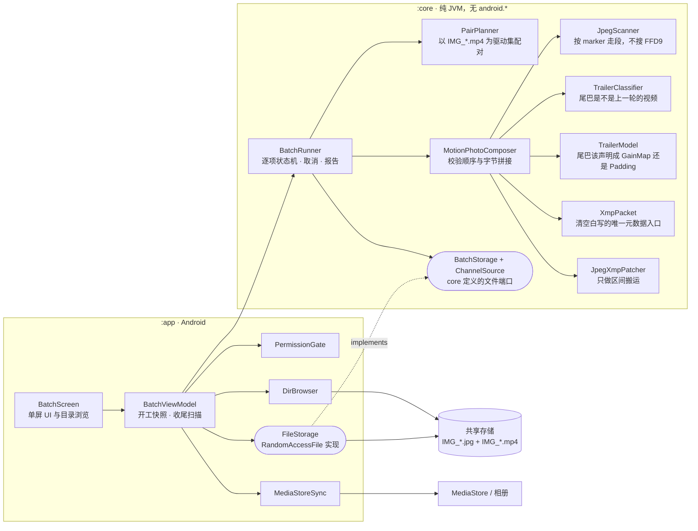

# live-photo-batch

Android 上的批量动态照片合成工具：选一个目录，把**同名**的 `.jpg` 与 `IMG_*.mp4` 合成一张符合
Google **Motion Photo 1.0** 的单文件动态照片，写到另一个目录。不解码、不转码、不重编码 —— 纯字节
拼接加元数据。

## 安装与使用

1. 装机：`./gradlew :app:assembleDebug` 产出 `app/build/outputs/apk/debug/app-debug.apk`，
   `adb install -r <apk>`。
2. 首次打开授予「所有文件访问权限」（`MANAGE_EXTERNAL_STORAGE`）。没有它就无法读写相机目录，
   应用会给出跳转入口。
3. 填源目录与目标目录（也可以「浏览…」逐级选）。目标目录不存在会自动创建；两个目录可以是同一个。
4. 「开始合成」跑批，「取消」在当前项落盘后停止。产物名 `<stem>_MP.jpg`，同名已存在则**覆盖**。
5. 「合成后删除原文件」默认不勾；勾上只在产物 rename 成功之后删 `x.jpg` 与 `x.mp4`，删除失败
   不影响本项成功状态，但会记进报告。

## 产物形态

```
SOI + 源图[2, 旧XMP起点) + 新 XMP APP1 + 源图[旧XMP终点, 文件大小) + 视频字节
```

- 源 JPEG **整文件**搬进产物，包括主图 `FFD9`(EOI) 之后的 HDR gain map 副图与 vivo 厂商记录；
  新 XMP 写回旧 XMP 段原来的位置，所以 EXIF `APP1` 仍排在 XMP `APP1` 之前。
- 视频原始字节追加在文件末尾，`GCamera:MicroVideoOffset` 等于视频字节数，
  因此 `文件大小 − MicroVideoOffset == 视频起点`。
- **唯一的例外是 vivo 相机的末盒**：视频末尾那个 `uuid` + 伪 UUID `vivoMediaExtInfo` 的盒里，
  JSON 的 `com.android.camera.livephoto` 值必须以字面量 `motionphoto` 开头，这台机器的相册才认
  （真机二分 2026-10-20，见 `VivoLivePhotoTail`）。相机自己写的是数字开头的 id，所以原样追加
  必然不认；合成时给它加前缀，两处长度填**改写后实际写出的字节数**。视频里没有这个盒就
  一个字都不改——不伪造厂商结构，产物与"原样追加"逐字节相同。
- XMP 从清空白写：源包里的 `hdrgm:`、`dc:`、厂商命名空间与源片自己的容器项都**不带进产物**；
  只有当尾巴确实是一张 gain map 时，才按规范补回 `hdrgm:Version="1.0"` 与 `GainMap` 项。

容器目录声明文件里**每一段字节**（规范 MUST：媒体项按目录顺序紧密封装）：

| `imageEnd` 之后的尾巴 | 目录 |
|---|---|
| 空 | `Primary` → `MotionPhoto` |
| 真 gain map（含 `urn:iso:std:iso:ts:21496-1` 或 `hdr-gain-map` 声明） | `Primary` → `GainMap(Length=整条尾巴)` → `MotionPhoto` |
| 其他字节（MPF 副图、厂商记录、零填充） | `Primary(Padding=尾巴长度)` → `MotionPhoto` |

## 核心逻辑

一个批次只有两级编排：`PairPlanner` 决定"有哪些活"，`BatchRunner` 决定"每项怎么落地"，
字节的判断全部集中在 `MotionPhotoComposer` 一条线上。整条链路都在 `:core`（纯 JVM、无
`android.*`）里，`:app` 只提供文件、权限、目录浏览和媒体扫描四件适配器 —— 两者编译进同一个
APK、同一个进程，边界是**构建隔离**而不是进程边界。



### 写第一个字节之前要过的关口

`MotionPhotoComposer.compose(image, video, sink)` 把判据按**便宜的放前面**排成一条线，任何一道
被拒就对 `sink` 一个字节都不写 —— 所以坏视频绝不会让你先白扫一遍 JPEG：

1. **视频头**：读开头 16 字节，前 12 字节内出现 `ftyp`？否 → `NOT_MP4`。
2. **JPEG 段遍历**：`JpegScanner` 按 marker 走，得出 `imageEnd`、旧 XMP 的**字节区间**和它的文本。
   绝不搜 `FFD9` 字节序列 —— 追加的视频里合法地会出现它。
3. **分块扩展 XMP**：有 → `EXTENDED_XMP_UNSUPPORTED`，不做处理。
4. **尾巴探针**：从 `imageEnd` 读 `min(16, 尾巴长)` 字节交给 `TrailerClassifier`。只有源 XMP 已声明过
   `video/`，或这段字节本身是 ISO-BMFF 盒子形状，才算"上一轮已经合成过" → `ALREADY_MOTION_PHOTO`。
   gain map 副图、厂商 JSON、零填充一律**放行**并原样搬进产物。
5. **尾巴定性**：`TrailerModel` 沿尾巴自己的 marker 走完一遍，副图 → `gainMapBytes`，其余一切形状
   （包括遍历不收敛的畸形副图）→ `paddingBytes`。这一步**永不抛**：声明成 Padding 永远合法，
   把坏图谎称 GainMap 才是骗目录。
6. **生成 XMP 包**：`XmpPacket` 清空白写，源包属性一个不掺。包体大到一个 APP1 的 16 位长度字段
   装不下，同样折成 `EXTENDED_XMP_UNSUPPORTED`。

全过之后才轮到写入：`JpegXmpPatcher.patch(...)` 按 `源图[0, 旧XMP起点) + 新 APP1 +
源图[旧XMP终点, 文件大小)` 搬运（旧段靠"读掉不写"丢弃），`copyToEnd` 再把 MP4 原始字节
64 KiB 一块流式追加。全程定长缓冲、常数内存，没有一处 `readBytes()`。

### 一项只有三条出路

`BatchRunner` 给每一项的生命周期定死了三条出路，三条都执行 `.part` 清理：

| 出路 | 结果 | 原文件 |
|---|---|---|
| 校验/合成被拒 | 无条件删 `.part` → `SKIPPED`（只有 `ALREADY_MOTION_PHOTO`）或 `FAILED(reason)` | 不动 |
| 合成成功但 rename 失败 | 删 `.part` → `FAILED(IO_ERROR)`，最终名上什么都没有 | 不动 |
| rename 成功 | **本项当场提交**：先建出 `SUCCESS`，之后才按勾选删图、删视频 | 删；删不掉的只进 `deleteFailures` 警告，**没有任何路径能回头把 SUCCESS 改成 FAILED** |

取消不是协程取消：`cancel()` 只翻一个 `@Volatile` 标志，由 `BatchRunner` 在**每一项之前**读
（`unpaired` 行也算一项）。正在写的那一项一定走完 rename 或 `.part` 清理，绝不留半截文件。

### 谁保证发布，谁保证可见

`BatchStorage.openWrite` 的契约只承诺"`close()` 成功返回后全部字节可见"，而真实的
`RandomAccessFile(file, "rw")` 一打开就创建并 truncate 到 0 —— 半途可见是文件系统事实，
改不了。所以发布是分工的：先写 `目标目录/.tmp/输出名.part`、`close()` 时 `force(true)`、
再用 `rename(2)` 换成正式名。`move` 的实现**绝不在改名前先删目标**，那会开出一个
"旧产物已经没了、新产物还没就位"的窗口。

失败分三层，别混：权限没给、源目录不可读、目标目录建不起来是**全局前置**，整批不开工，
只给一行提示；坏文件与磁盘故障是**单项失败**，进报告、批次继续；原文件没删掉是**警告**，
跟着 SUCCESS 一起显示。

### 配对为什么以视频驱动

驱动集是 `IMG_*.mp4` 而不是 JPEG：相机目录里绝大多数 JPEG 是普通照片，根本没有配对视频，
以它们驱动时每个都要产一条"缺视频"的跳过记录（真机第一批 54 项里 28 项是这种噪声）。
没视频就不是动态照片，这是常识不是异常。`IMG_` 前缀这一刀顺带把录屏、下载的短视频和聊天工具
存下来的 mp4 挡在门外。剩下的配对异常只有一种：有 `IMG_*.mp4` 却找不到同名图像。

## 架构图文档

- [docs/architecture/live-photo-batch.structurizr.dsl](docs/architecture/live-photo-batch.structurizr.dsl)
  —— C4 的 Context / Container / 两个 Component 视图（Qoder 的 Structurizr DSL 视图可预览）。
- [docs/architecture/compose-pipeline.dot](docs/architecture/compose-pipeline.dot)
  —— 上面那条"一项从 PairJob 到 ItemResult"的流水线源文件，另有已渲染的
  [compose-pipeline.svg](docs/architecture/compose-pipeline.svg)（派生产物，别手改）。
- [docs/architecture/system-model.evidence.md](docs/architecture/system-model.evidence.md)
  —— 每个节点、每条边的 `file:line` 证据、置信度、未决项，以及**与 spec §6 那节过期模块表的 5 处分叉**。
  那份文件开头还记了三张图各自的**渲染验证状态**：DOT 与 mermaid 是拿真 Graphviz 16.1.0 / 真 mermaid
  在浏览器里跑过并量过边界的；Structurizr DSL **没有**机器验证（本机无 Java，npm 上那个解析器发布包里
  连 `dist/` 都没有），所以它按官方文法手写，请在应用内视图里确认。

## 实测（vivo V2419A，Android 16）

- 26 对 vivo 原片 / 222 MB 一批跑完约 **3 秒**（产物 rename 时间戳集中在同一 3 秒窗口内），
  `成功 26 · 跳过 28 · 失败 0`；那 28 项跳过是改配对方向**之前**的形态（普通照片被报成"缺视频"）。
  现在同样的目录只会报出真正异常的项：有 `IMG_*.mp4` 却找不到同名图像。
- 取消：跑批中途打断，进度停在 35/54，`.tmp` 无 `.part` 残留。
- 覆盖：先在目标路径放一个 1 字节的假产物，重跑一批后被替换为 9,151,135 字节的真产物且 inode 变更，
  两次产物 md5 相同 → rename 覆盖生效、合成确定性。
- 相册：⚠ **这条原来写的「vivo 相册把 `_MP.jpg` 当动态照片，可播放」是错的** —— 当时看的是 Immich，
  不是 vivo 相册。真机复核：vivo 相册**不认**我们的产物，而 OPPO / 小米 14 / 小米 15 的 live 照片它
  都认。定位到的共线变量与"取规范还是取机型"的裁定，见「已知偏离」末条与 spec 增补 2026-10-19e §4。
- 测试：`:core:test` 127 条、`:app:testDebugUnitTest` 24 条，`assembleDebug` 无警告。
  ⚠ 这组数字是 2026-10-19e **之前**那份 1,024 字节的包拿到的；包体现在是 1,057 字节，跑测试前
  `Fixtures.specPacketTemplate` 那份字节钉桩已按新值更新，但**没有重新在真机上跑过这批测试**
  （本机无 Java，`./gradlew` 起不来，见「开发」）。

## 已知偏离与取舍

- **产物比"两文件之和"还略大**：主图与副图字节一字不动。桌面端 live-photo-conv 对 JPEG 主图也是
  整文件拷贝；网上常见的"更小"的动态照片其实走了重编码分支（主图被重新压缩、副图与厂商段被丢掉），
  那是有损的，本项目不做。
- `GainMap` 的 `Item:Length` 写的是**整条尾巴**（含副图 JPEG 之后的厂商统计记录），不是副图自身的
  诚实长度。规范只允许第一项带 `Padding`，副图与视频之间的空隙无处声明；写诚实长度就会留下
  未声明字节、违反"紧密封装"MUST。JPEG 解码器读到自己的 `FFD9` 就停，多出的尾巴无害。
- 相机命名空间用 `GCamera` 前缀（规范默认前缀是 `Camera`）：URI 一致即可，Pixel 自己的产物也写
  `GCamera`。
- 四个 `GCamera:MicroVideo*` 属性：规范明确它们"已从本规范删除，若存在必须被忽略"。**"vivo 只读
  它们"这句已被实测推翻**——那三份被 vivo 认的第三方样本里 `MicroVideo` 字样零命中，删掉这四个
  属性的变体在这台 V2419A 上照样不认（真正起作用的是末盒的 `livephoto` 前缀，见上）。保留它们
  只为兼容还在读老字段的读取方，不再当作识别依据。
- 文件名 `<stem>_MP.jpg` 满足规范建议的 `^([^\s/\\][^/\]*MP)\.(JPG|jpg|…)`，与 Pixel 同形。
- 配对**以视频驱动**：只有 `IMG_*.mp4`（前缀大小写不敏感）会去找同名 `.jpg`/`.jpeg`。
  没有配对视频的普通照片**不产生任何记录**——它不是动态照片，这是常识不是异常；
  录屏与下载的短视频也被 `IMG_` 前缀挡在门外。报告里只剩"有视频找不到图"这一种配对异常。
  扩展名大小写不敏感，stem 匹配严格区分大小写（Android 文件系统语义）。
- 只处理一层目录，不递归。
- 分块扩展 XMP（`http://ns.adobe.com/xmp/extension/`）不处理，报 `EXTENDED_XMP_UNSUPPORTED`。
- **`Primary` 项写 `Item:Length="0"`**（spec 增补 2026-10-19e）：规范正文是"主媒体内容的长度应为 0"，
  不是"若写则应为 0"。包体 1,024 → **1,057** 字节（无副图那支）。`rdf:li` 的序列化形状与属性顺序
  **不动**——规范整页没有示例包，那两处没有规范性差异，不该为了对齐厂商样本去改（一度改过，已回退）。
- **"规范与这台机器的识别不能两全"这个前提已经不成立。** 之前记录的共线变量是"EOI 与视频之间
  有没有未声明的间隙"，真机二分（2026-10-20）把它否掉了：把间隙压到 0（截到 EOI）而末盒没改，
  照样不认；反过来带着 370,776 字节的 HDR 副图、目录如实三项声明、间隙非 0，只要末盒的
  `livephoto` 值加上 `motionphoto` 前缀，就被认、就能播。所以"守规范"与"被识别"可以同时成立，
  18d/19e 那次"取规范、接受不被认"的裁定可以撤销——剩下的识别条件只有末盒这一条。
  厂商样本仍留作反例：OPPO 的 `GainMap.Length`（585,268）声明了文件里根本不存在的副图，那个数字
  抄自它自己 APP2 MPF 段的属性表；`MotionPhoto.Length` 写整条尾巴以致按目录累加**溢出文件末尾**
  585,268 字节；还在非首项上写 `Padding`（规范明令禁止）。它被机型认，但不合规。

## 开发

```bash
export JAVA_HOME="<你的 JDK>"        # Windows 上 Android Studio 自带的 jbr 可用
./gradlew :core:test                 # 纯 JVM 的格式与批次逻辑，127 条
./gradlew :app:testDebugUnitTest     # ViewModel / 路径 / 存储，24 条
./gradlew :app:assembleDebug
```

`core` 不依赖 Android：JPEG 段遍历、XMP 包生成、容器目录、配对与批次全在那里，可以脱离设备跑测试。
它认识的**全部**文件动作就是 `BatchStorage` + `ChannelSource` 这一个端口（字符串路径、`/` 分隔符），
`:app` 的 `FileStorage` 和测试里的 `InMemoryStorage` 各自实现它 —— 这就是 127 条 `:core` 测试
不需要设备的原因。`app` 只做权限、目录浏览、进度 UI 与 MediaStore 收敛。

模块与字节布局的设计依据见 `docs/superpowers/specs/`，实现步骤见 `docs/superpowers/plans/`；
其中 spec §6「架构与模块边界」那张表已经过期（`NestedMotionPhotoDetector`、`FileSystemGateway`、
`MediaStoreGateway` 都不存在，也漏了 `TrailerClassifier` 与 `TrailerModel`），现状以
[docs/architecture/system-model.evidence.md](docs/architecture/system-model.evidence.md)
末尾那处分叉清单为准。
